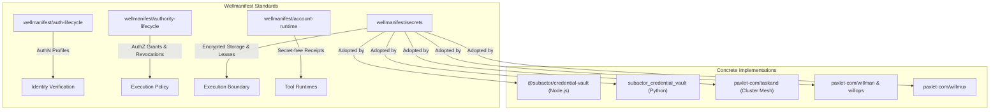

# Wellmanifest Secrets Architecture (`wellmanifest/secrets`)

## 1. Domain Separation & Wellmanifest Ecosystem

The Wellmanifest policy-as-code federation maintains strict boundary separation:

### Boundary Responsibilities

- **`wellmanifest/secrets` (This Standard)**: Owns the cryptographic envelope format (`wellmanifest.secrets/envelope/v1`), storage manifest schema, POSIX permission contract, origin-binding logic, and bounded lease protocol.
- **`wellmanifest/auth-lifecycle`**: Defines AuthN mechanisms (e.g. `otp-email`, `access-api`). It never mints authority grants or holds secret vaults.
- **`wellmanifest/authority-lifecycle`**: Issues and revokes machine authority grants. It consumes secret lease shapes but does not manage symmetric crypto keys.
- **`wellmanifest/account-runtime`**: Emits secret-free tool receipts and maintains isolated execution environments.

---

## 2. Comparison with Industry Vault Solutions

| Feature | HashiCorp Vault KV v2 | Ansible Vault | Linux SecretService / Keyring | **`wellmanifest/secrets`** |
| :--- | :--- | :--- | :--- | :--- |
| **Primary Target** | Distributed cloud clusters | Static repo playbooks | Local desktop user keyring | Heterogeneous AI agent fleets & micro-services |
| **At-Rest Crypto** | AES-256-GCM / Shamir | AES-256 | System-dependent | AES-256-GCM + scrypt KDF |
| **Origin Binding** | Via policies / paths | None | Application appId | Strict RFC 3986 network origin validation |
| **Scope Enforcement**| Path ACLs | File level | Collection level | Typed operations and targets |
| **Runtime Overhead** | Heavyweight daemon | CLI only | D-Bus daemon required | Zero-dependency file or lightweight HTTP lease |
| **Atomic Persistence**| Raft / Consul | Temp files | SQLite / flat file | Atomic temp file write + POSIX rename |

---

## 3. Threat Model and Mitigations

| Threat | Attack Vector | Mitigation in `wellmanifest/secrets` |
| :--- | :--- | :--- |
| **Local File Read by Other Users** | Shared multi-user OS environment | Strict POSIX `0600` file mode + `0700` parent dir; fail-closed check on open. |
| **Ciphertext Tampering** | Bit-flipping attack on ciphertext | AES-256-GCM 16-byte authentication tag; any modification rejects payload. |
| **Secret Exfiltration across Domains**| SSRF or rogue agent passing credentials to arbitrary hosts | Origin-bound validation; credentials for `api2.wfirma.pl` cannot be read for other origins. |
| **Leaked Credentials in Git/Logs** | Accidental dump of environment or config | Masking `••••••••` in all list views and receipts; secrets revealed only at lease boundary. |
| **Process Crash Mid-Write** | Power loss or SIGKILL during disk write | Atomic write using sibling `.tmp` file and single atomic `rename` call. |
